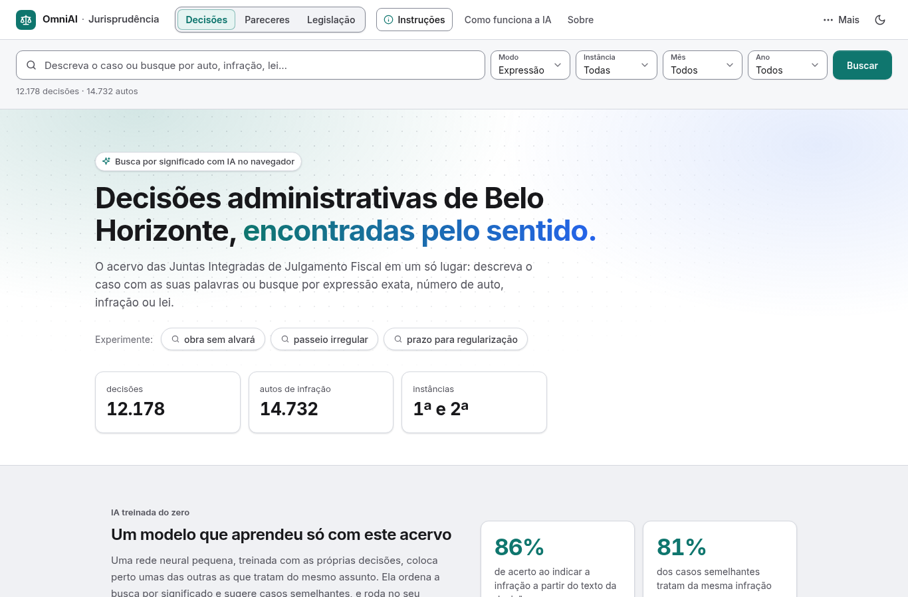
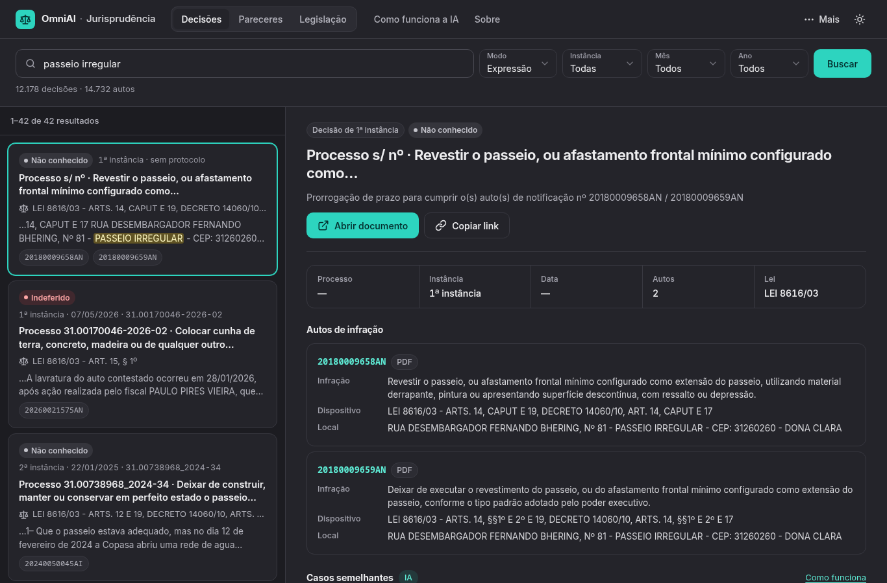
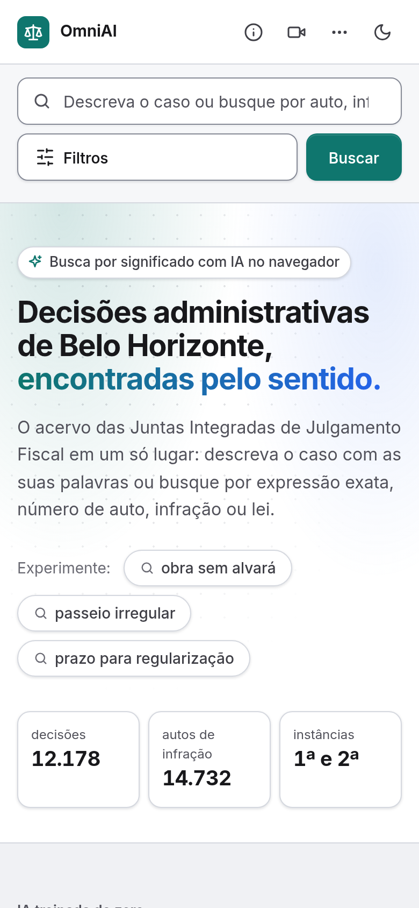
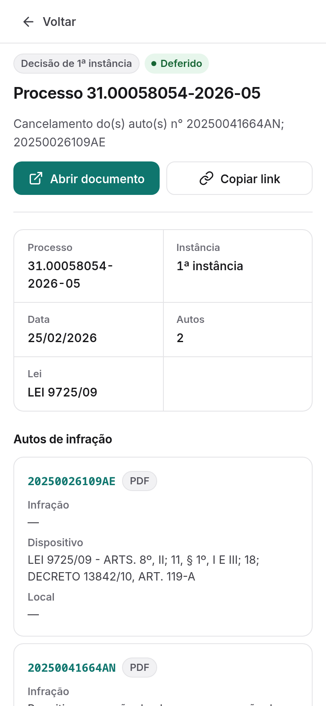
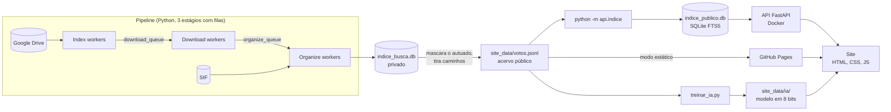
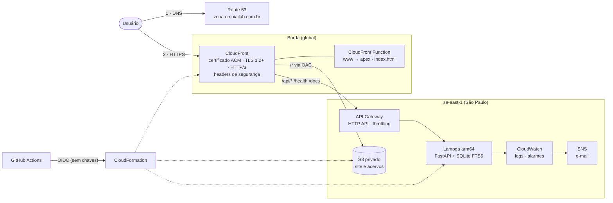

# OmniAI · Jurisprudência

[](https://github.com/sauliiin/jurisprudencia-juntas/actions/workflows/ci.yml)
[](https://github.com/sauliiin/jurisprudencia-juntas/actions/workflows/deploy-aws.yml)
[](https://github.com/sauliiin/jurisprudencia-juntas/actions/workflows/ci.yml)


[](LICENSE)

> **English summary.** Search engine for ~12,000 administrative decisions from Belo Horizonte's
> tax and inspection appeal boards. A concurrent Python pipeline (three stages linked by queues)
> collects decisions from Google Drive, extracts text from PDF/DOCX/Google Docs, enriches them with
> data from the city's inspection system and builds a SQLite FTS5 index. Personal data is masked
> before publication. A **FastAPI** service (typed responses, validation, structured logs, health
> check, Docker) serves search, and a dependency-free web front end runs a **neural model trained
> from scratch in the browser** for semantic search and similar cases (86% infraction accuracy,
> 81% precision@5 on held-out data). Tested with pytest (99% coverage), linted with ruff, built and
> smoke-tested in GitHub Actions. Deployed serverless on AWS (CloudFront, private S3 with OAC, API Gateway,
> Lambda on Graviton, Route 53, ACM) with CloudFormation/SAM and keyless GitHub Actions deploys via OIDC.
> Next step: answers generated with Bedrock.



**Site:** [omniailab.com.br](https://omniailab.com.br) (AWS serverless: CloudFront, S3, API Gateway e Lambda,
[detalhes](#na-aws)) · espelho estático no
[GitHub Pages](https://sauliiin.github.io/jurisprudencia-juntas/)

## O que é

As decisões das Juntas Integradas de Julgamento Fiscal de Belo Horizonte ficavam espalhadas em pastas
do Google Drive, em PDF, Word e Google Docs, sem busca pelo conteúdo e sem os dados do auto de infração,
que estão em outro sistema (SIF). Este projeto junta tudo num buscador:

- um **pipeline em Python** baixa e lê cada decisão, cruza com os autos do SIF e monta o índice;
- o acervo é **publicado com os dados pessoais mascarados**;
- uma **API em FastAPI** faz a busca textual (SQLite FTS5, ranking BM25);
- o **site** busca por expressão, por palavras ou por significado, com uma **IA treinada do zero**
  que roda no navegador e sugere casos semelhantes.

| Acervo | Números |
| --- | --- |
| Decisões (1ª e 2ª instância) | 12.178 |
| Autos de infração citados | 14.732 |
| Infrações distintas | 204 |
| Pareceres e ofícios | 314 |
| Legislação (artigos e itens) | 3.065, de 22 normas |

## Funcionalidades

- **Três modos de busca:** expressão exata, todas as palavras (com prefixo e sem acento) e
  significado (IA), com filtros por instância, mês e ano.
- **Decisão completa:** texto com os termos destacados, autos com infração, dispositivo legal e local,
  link para o documento original e link direto para compartilhar (`?voto=`).
- **Casos semelhantes:** as cinco decisões mais parecidas e como cada uma foi julgada.
- **Pareceres e legislação:** os mesmos recursos para o acervo de pareceres e para a legislação municipal
  dividida em artigos, com "artigos semelhantes".
- **Pergunte ao Entendimento:** pergunta em português respondida por um modelo de linguagem só com base no
  Entendimento das Juntas (Vade Mecum, 2024), citando o tópico usado ([detalhes](#pergunte-ao-entendimento)).
- **Visual atual:** temas claro, escuro e cyberpunk (a paleta neon do site original), layout de celular com filtros recolhidos e detalhe em tela cheia,
  acessibilidade (contraste AA, foco visível, navegação por teclado).
- **Dois modos de implantação:** com a API (busca no servidor, download inicial pequeno) ou estático no
  GitHub Pages (o navegador baixa o acervo e busca sozinho).

<p align="center">
  
  
  
</p>

## IA do site

Uma rede neural pequena (TF-IDF → 128 dimensões), treinada em NumPy para reconhecer a infração do auto a
partir do texto da decisão, aprende no caminho a aproximar decisões do mesmo assunto. Os pesos vão para o
navegador em 8 bits (5,5 MB) e a consulta é calculada localmente: nada do que se digita sai do computador.
O modelo é refeito do zero a cada atualização do acervo (`treinar_ia.py`).

Medido em 1.802 decisões fora do treino, com a infração registrada no SIF como gabarito:

| Métrica | Valor |
| --- | --- |
| Acerto ao indicar a infração (entre 204) | **86%** |
| Casos semelhantes com a mesma infração (precision@5; ao acaso: 4%) | **81%** |
| Busca a partir do relato do fiscal (MRR@10) | **0,60** |

Detalhes em [site_publico/ia.html](site_publico/ia.html) e [treinar_ia.py](treinar_ia.py).

## Pergunte ao Entendimento

A página [`pergunte/`](site_publico/pergunte/) responde perguntas sobre um único documento, o
**Entendimento das Juntas** (`ENTENDIMENTO JUNTAS 2024.docx`, Vade Mecum de jurisprudência administrativa).
Quem pergunta não baixa nada: tudo roda no servidor.

```text
pergunta -> /api/perguntar (Lambda)
  -> BM25 sobre os 44 tópicos do Entendimento: os até 3 que tratam da pergunta (milissegundos)
  -> só esses tópicos (até 6 mil caracteres) vão para o modelo, com a ordem de responder só com base neles e citar [n]
  -> as citações são conferidas no código: número que não é de um tópico enviado sai
  -> resposta + texto integral dos tópicos citados, para conferir
```

- **Grátis:** o modelo é chamado num serviço com plano gratuito. O padrão é o Groq (`qwen/qwen3.8-27b`),
  mas qualquer endpoint no formato da OpenAI serve (Gemini, OpenRouter, Cloudflare Workers AI): basta trocar
  `JURIS_LLM_URL` e `JURIS_LLM_MODELO`. Mandar só os tópicos certos, e não o documento inteiro (~22 mil
  tokens), é o que faz a cota gratuita render.
- **Nunca fica sem resposta:** sem chave, com o limite gratuito esgotado ou com o serviço fora do ar, a página
  mostra os tópicos encontrados, com um aviso. Pergunta sem nenhum termo do Entendimento nem chega ao modelo.
- **Cota protegida:** a rota tem limite próprio no API Gateway (1 pergunta/s, picos de 3).
- **Sem dados no log:** o log registra o tamanho da pergunta e o resultado, não o texto.

Os tópicos saem de `site_data/pareceres.jsonl` com o mesmo parser do assistente offline
([api/entendimento.py](api/entendimento.py)); o build do Lambda grava `entendimento.json` no pacote. Rodando
local sem esse arquivo, a API lê o documento direto do acervo.

**Configurar a chave (uma vez).** Crie a chave no provedor (no Groq: console.groq.com → API Keys) e guarde no
SSM Parameter Store da AWS como SecureString (o nível padrão é gratuito). A chave não fica no GitHub nem no
template:

```bash
aws ssm put-parameter --region sa-east-1 --name /omniailab/llm-api-key --type SecureString --value "SUA_CHAVE"
```

O Lambda lê o parâmetro na primeira pergunta (permissão só para ele, no template). Para trocar a chave, rode o
mesmo comando com `--overwrite`; a nova vale quando o Lambda reiniciar (ou no próximo deploy). Local:
`JURIS_LLM_API_KEY=SUA_CHAVE python -m api`.

## Arquitetura



- **Pipeline** ([docs/pipeline.md](docs/pipeline.md)): três estágios em paralelo desde o início, retry com
  backoff nas falhas de rede, sincronização incremental pelo `modifiedTime` do Drive e retomada por um
  marco versionado.
- **Índice público:** a API nunca abre o índice privado do pipeline; lê um SQLite gerado do JSONL já
  mascarado, com as mesmas tabelas e a mesma busca FTS5.
- **API** ([api/](api/)): rotas finas, regra de busca em `api/services/`, schemas Pydantic, configuração
  por ambiente e o site servido no mesmo processo.
- **Site** ([site_publico/](site_publico/)): sem framework e sem build; se a API não responder, cai para o
  modo estático.

## Na AWS

O site e a API rodam em **https://omniailab.com.br** numa arquitetura **100% serverless** na região
**sa-east-1 (São Paulo)**, desenhada pelos seis pilares do **AWS Well-Architected Framework**. Toda a
infraestrutura é código ([`infra/aws/`](infra/aws/)) e cada push no `main` publica sozinho, sem chaves de
acesso guardadas no GitHub.

| Em números | |
| --- | --- |
| Servidores ligados | 0 (paga só por requisição) |
| Serviços AWS | 11: Route 53, ACM, CloudFront, S3, API Gateway, Lambda, IAM, CloudFormation, CloudWatch, SNS, Budgets |
| Stacks CloudFormation | 3 (bootstrap, certificado, aplicação) |
| Download do acervo no modo estático | 16 MB em vez de 66 MB (gzip prévio) |
| Custo esperado | ~US$ 1/mês com tráfego baixo |

### Arquitetura



### Caminho de uma busca

1. O navegador resolve `omniailab.com.br` no **Route 53**, que responde com um registro *alias* (A e AAAA)
   para a distribuição do CloudFront.
2. O **CloudFront** encerra o HTTPS na borda mais próxima (há pontos de presença no Brasil) com o
   certificado do **ACM**.
3. Páginas, scripts e acervos (`/*`) vêm do cache da borda. Se não estiverem lá, o CloudFront busca no
   **S3**, assinando o pedido com **OAC** (Origin Access Control). O bucket não aceita nenhum outro acesso.
4. A busca (`/api/search`) segue para o **API Gateway**, que limita a taxa de requisições e chama o
   **Lambda**. A função roda a mesma API FastAPI do Docker e consulta o índice SQLite FTS5 empacotado com
   ela, sem ir à rede atrás de um banco.
5. A IA de busca por significado não passa pelo servidor: o modelo vai para o navegador e roda lá.

### Serviços e por que cada um

| Serviço | Papel | Por que este |
| --- | --- | --- |
| **Route 53** | DNS do domínio | Registro *alias* no apex (CNAME não pode no apex) e validação automática do certificado |
| **ACM** | Certificado TLS | Gratuito, renova sozinho; criado em **us-east-1**, a única região que o CloudFront aceita |
| **CloudFront** | CDN e porta única de entrada | Cache perto do usuário, HTTPS, HTTP/3 e IPv6; site e API no mesmo domínio, sem CORS |
| **CloudFront Functions** | Regras na borda | Redireciona `www` e completa `index.html` em menos de 1 ms, mais barato que Lambda@Edge |
| **S3** | Site estático e acervos | Durabilidade de 11 noves, privado com OAC (sucessor do OAI) |
| **API Gateway (HTTP API)** | Entrada da API | Mais barata e com menos latência que a REST API; throttling de 20 req/s (pico de 40) |
| **Lambda (arm64)** | API FastAPI | Escala de 0 a N sozinha; Graviton custa menos e gasta menos energia que x86 |
| **CloudFormation / SAM** | Infraestrutura como código | Ambiente reproduzível e versionado; SAM simplifica Lambda e API Gateway |
| **IAM + OIDC** | Identidade do deploy | O GitHub recebe credenciais temporárias; nada de access key de longa duração |
| **CloudWatch + SNS** | Logs e alarmes | Logs JSON com `request_id`, retidos 30 dias; alarmes vão por e-mail |
| **Budgets** | Controle de custo | Alerta em 80% do gasto real e 100% do previsto, com teto de US$ 5/mês |

### Os seis pilares do Well-Architected

| Pilar | O que foi feito |
| --- | --- |
| **Excelência operacional** | Infraestrutura 100% em código; deploy, invalidação de cache e *smoke test* automáticos a cada push; logs estruturados com `request_id` de ponta a ponta |
| **Segurança** | Defesa em camadas (detalhes abaixo); menor privilégio em todas as identidades; dados pessoais mascarados antes de qualquer publicação |
| **Confiabilidade** | Só serviços gerenciados e multi-AZ; versionamento do bucket (volta a qualquer versão em 30 dias); se a API falhar, o site cai sozinho para o modo estático e continua buscando |
| **Eficiência de performance** | Cache na borda; HTTP/3; acervos comprimidos antes do envio (o CloudFront só comprime arquivos de até 10 MB); índice dentro do pacote do Lambda, sem rede até o banco |
| **Otimização de custos** | Nada ligado sem uso; HTTP API em vez de REST API; Graviton; SQLite em vez de RDS (sem custo fixo); orçamento com alerta |
| **Sustentabilidade** | Zero recursos ociosos; Graviton; cache e compressão reduzem bytes trafegados e chamadas à origem |

### Segurança em camadas

- **Rede e borda:** só HTTPS (HTTP redireciona), TLS 1.2 ou superior, `SecurityHeadersPolicy` (HSTS,
  `X-Content-Type-Options`, `X-Frame-Options`, `Referrer-Policy`).
- **Armazenamento:** Block Public Access ligado, ACLs desativadas (`BucketOwnerEnforced`), criptografia
  SSE-S3, política que libera leitura só para **esta** distribuição (`aws:SourceArn`) e nega qualquer acesso
  sem TLS. Abrir a URL do bucket direto devolve 403.
- **Identidades:** a role de deploy só pode ser assumida pelo branch `main` deste repositório (condição
  `sub` do token OIDC) e só mexe em recursos com prefixo `omniailab-*`. A função Lambda não tem permissão
  para nenhum outro serviço além dos próprios logs.
- **Dados:** a API lê só o índice público, gerado do acervo já mascarado, em modo somente leitura.
- **Abuso e custo:** throttling no API Gateway e alarme de orçamento.

### Infraestrutura como código

| Stack | Região | O que cria | Quem aplica |
| --- | --- | --- | --- |
| [`omniailab-bootstrap`](infra/aws/bootstrap.yaml) | sa-east-1 | Zona do Route 53, bucket de artefatos, provedor OIDC, role de deploy, orçamento | Console, uma vez |
| [`omniailab-certificado`](infra/aws/certificado.yaml) | us-east-1 | Certificado ACM com validação DNS automática | GitHub Actions |
| [`omniailab-app`](infra/aws/template.yaml) | sa-east-1 | S3, OAC, CloudFront, CloudFront Function, HTTP API, Lambda, registros DNS, logs e alarmes | GitHub Actions |

### Deploy contínuo

O workflow [`deploy-aws.yml`](.github/workflows/deploy-aws.yml) roda a cada push no `main` que toque o site, a
API, os acervos ou a infraestrutura:

1. Gera o índice público a partir do acervo mascarado.
2. Monta o pacote do Lambda para arm64 ([`build_lambda.sh`](infra/aws/build_lambda.sh)): código, dependências
   e índice, ~183 MB de 250 MB permitidos.
3. Assume a role da AWS por **OIDC**.
4. Aplica o stack do certificado e o da aplicação (CloudFormation *change sets*: só o que mudou é alterado).
5. Envia o site ao S3 com `Cache-Control` adequado e os acervos já em gzip.
6. Invalida o cache do CloudFront.
7. Faz o *smoke test* no domínio: `/health`, a página inicial e uma busca real.

### Decisões e alternativas descartadas

| Decisão | Alternativa | Por quê |
| --- | --- | --- |
| Lambda + API Gateway | EC2 + ALB + Auto Scaling | Tráfego baixo e irregular: o ALB sozinho custaria mais que toda a solução |
| SQLite FTS5 dentro do pacote | RDS PostgreSQL ou OpenSearch | Índice somente leitura, trocado a cada deploy; busca BM25 em milissegundos sem custo fixo de banco |
| HTTP API | REST API | Mais barata e mais rápida; os recursos extras da REST API (chaves de uso, transformações) não são usados |
| OAC | OAI ou bucket público | OAC é o mecanismo atual e assina com SigV4; bucket público expõe os arquivos fora do CDN |
| CloudFront Function | Lambda@Edge | Regras simples de URL não precisam de Lambda@Edge, que é mais cara e mais lenta |
| Uma região (sa-east-1) | Multirregião | A borda do CloudFront já é global; a confiabilidade multi-AZ basta para o caso de uso |

Quando o índice passar do limite do pacote, o próximo passo é publicar a função como imagem de contêiner (até
10 GB) ou montar o índice via EFS. Reproduzir em outra conta e estimativa de custos: [docs/aws.md](docs/aws.md).

## Como rodar

### Com Docker (recomendado)

```bash
docker compose up --build
```

Abra <http://localhost:8000> (site) e <http://localhost:8000/docs> (API). O compose gera o índice público a
partir de `site_data/` num volume e sobe a API depois dele, com usuário sem privilégios, sistema de arquivos
só de leitura e health check.

### Local

```bash
python3 -m venv .venv && source .venv/bin/activate
pip install -r requirements-dev.txt
python -m api.indice          # site_data/votos.jsonl -> indice_publico.db (alguns segundos)
python -m api                 # http://127.0.0.1:8000
```

Sem a API, o site também roda como arquivos estáticos (`python3 -m http.server`, abrindo `/site_publico/`).

### Configuração

Variáveis de ambiente com prefixo `JURIS_` (padrões para rodar local em [api/config.py](api/config.py)):

| Variável | Padrão | Para quê |
| --- | --- | --- |
| `JURIS_INDICE` | `indice_publico.db` | Índice SQLite público |
| `JURIS_SITE_DIR` | `site_publico/` | Site servido em `/site_publico/` |
| `JURIS_DADOS_DIR` | `site_data/` | Acervos e modelo da IA, em `/site_data/` |
| `JURIS_ARQUIVOS_DIR` | vazio | Originais para `/api/file`; vazio desliga a rota |
| `JURIS_CORS_ORIGINS` | vazio | Origens liberadas (JSON ou separadas por vírgula) |
| `JURIS_HOST` / `JURIS_PORT` | `127.0.0.1` / `8000` | Endereço do servidor |
| `JURIS_WORKERS` | `1` | Processos do uvicorn |
| `JURIS_MAX_LIMIT` | `100` | Máximo de resultados por página |
| `JURIS_LOG_LEVEL` | `INFO` | Nível dos logs (JSON, uma linha por evento) |
| `JURIS_ENTENDIMENTO` | `entendimento.json` | Tópicos do Entendimento; sem o arquivo, lê de `site_data/pareceres.jsonl` |
| `JURIS_LLM_URL` | endpoint do Groq | Chat no formato da OpenAI usado em `/api/perguntar` |
| `JURIS_LLM_MODELO` | `qwen/qwen3.8-27b` | Modelo desse endpoint |
| `JURIS_LLM_API_KEY` | vazio | Chave do serviço (uso local) |
| `JURIS_LLM_API_KEY_SSM` | vazio | Parâmetro SecureString do SSM com a chave (uso no Lambda) |
| `JURIS_LLM_TIMEOUT` / `JURIS_LLM_MAX_CHARS` | `12` / `6000` | Espera pelo modelo (s) e texto enviado por pergunta |

No front, a URL da API fica em [site_publico/config.js](site_publico/config.js) (`API_BASE`).

## API

Documentação interativa em `/docs` (OpenAPI).

| Rota | Descrição |
| --- | --- |
| `GET /health` | Status e se o índice está acessível (503 se não estiver) |
| `GET /api/stats` | Decisões, autos e documentos pulados pelo pipeline |
| `GET /api/search` | Busca paginada: `q`, `modo` (`phrase`, `words`), `instancia`, `mes`, `ano`, `limit`, `offset` |
| `GET /api/voto/{file_id}` | Decisão completa, com texto e autos |
| `GET /api/file/{file_id}` | Arquivo original (só com `JURIS_ARQUIVOS_DIR`) |
| `GET /api/perguntar` | Pergunta (`q`) respondida a partir do Entendimento das Juntas: `resposta`, `aviso` e `fontes` |

```bash
curl "http://localhost:8000/api/search?q=obra%20sem%20alvar%C3%A1&modo=phrase&limit=1"
```

```json
{
  "items": [
    {
      "file_id": "1e3e1zkqMjA2D7m_-l7yc8tjzXeKDDvfC",
      "protocolo": "31.00058054-2026-05",
      "decisao_instancia": "Decisão de 1ª instância",
      "data": "2026-02-25",
      "resultado": "deferido",
      "trecho": "...realmente iniciou uma <mark>obra sem alvará</mark> de construção...",
      "autos": [{ "numero": "20250026109AE", "lei": "LEI 9725/09" }]
    }
  ],
  "total": 38,
  "limit": 1,
  "offset": 0
}
```

(Resposta resumida; os itens trazem também links, extensão, nome do arquivo mascarado e todos os campos dos
autos.) Erros seguem um formato único, com o `request_id` que também vai no cabeçalho `X-Request-ID` e nos
logs:

```json
{"erro": {"codigo": "parametros_invalidos", "mensagem": "Parâmetros inválidos",
          "detalhes": [{"campo": "instancia", "problema": "Input should be 'todas', '1a_instancia' or '2a_instancia'"}],
          "request_id": "3542d2bef8e3415b"}}
```

## Testes e qualidade

```bash
pytest --cov          # 90 testes, 99% de cobertura no pacote api/
ruff check . && ruff format --check .
```

Os testes montam um índice SQLite com decisões fictícias e cobrem cada rota: busca por expressão e por
palavras, filtros, paginação, limites, erros 400/404/422/503, health check, arquivos, CORS e logs. A CI
([.github/workflows/ci.yml](.github/workflows/ci.yml)) roda lint, testes com cobertura e o build da imagem,
sobe o compose e faz um smoke test.

## Privacidade

O acervo é público, mas as pessoas autuadas não precisam ser:

- o nome do autuado sai dos autos e é trocado por `[AUTUADO]` no texto, no assunto, no nome do arquivo e no
  local da constatação, sem diferenciar caixa, acentos, espaços e pontuação;
- caminhos internos (`caminho_bruto`) não são publicados;
- os títulos na tela usam só processo, infração e resultado;
- a API lê só o índice gerado do acervo mascarado, e `/api/file` fica desligado por padrão;
- em `/api/perguntar`, a pergunta vai ao serviço de IA (a página avisa para não digitar dados pessoais), e o
  log da API não guarda o texto dela;
- [scripts/verificar_acervo_publico.py](scripts/verificar_acervo_publico.py) confere o que foi publicado.

Limites conhecidos: nomes de terceiros (requerentes, procuradores, fiscais) e números de CPF/CNPJ citados no
texto não são mascarados, e o botão "Abrir documento" leva ao arquivo original no Google Drive.

## Roadmap

1. **AWS: feito.** Site e API em produção, serverless, seguindo o AWS Well-Architected Framework; veja
   [docs/aws.md](docs/aws.md). Próximo passo de infraestrutura: índice em imagem de contêiner ou EFS quando
   passar do limite do pacote do Lambda.
2. **Respostas com IA: começou pelo Entendimento das Juntas** ([Pergunte ao Entendimento](#pergunte-ao-entendimento)).
   Próximo: estender às decisões recuperadas pela busca, sempre com a citação de cada uma.
3. Mascarar também CPF/CNPJ e nomes de terceiros no acervo publicado.

## Estrutura

```text
api/                  API FastAPI (rotas, serviço de busca, schemas, config, gerador do índice, entrada do Lambda)
infra/aws/            infraestrutura como código (CloudFormation/SAM) e build do pacote do Lambda
tests/                testes da API (pytest)
site_publico/         site: busca, detalhe, páginas Sobre e IA, pareceres e legislação
site_data/            acervo público (JSONL) e modelo da IA (versionados)
docs/                 documentação do pipeline, capturas de tela e fonte da imagem de compartilhamento
baixar_e_organizar_por_ato.py   pipeline de 3 estágios (Drive → texto → SIF → lei/ato)
preparar_acervo_publico.py      índice privado e exportação do JSONL mascarado
preparar_pareceres.py, legislacao.py   acervos de pareceres e legislação
treinar_ia.py         treino da IA do site
atualizar_tudo.sh     atualização completa: pipeline, IA, índice público e publicação
```

O pipeline (credenciais do Google, `.env` com o acesso ao SIF, opções e saídas) está documentado em
[docs/pipeline.md](docs/pipeline.md). O acervo também alimenta o JurisAI, projeto de RAG e agentes em
desenvolvimento.

## Licença

[MIT](LICENSE) · Saulo Hugo Rossi · [github.com/sauliiin](https://github.com/sauliiin)
