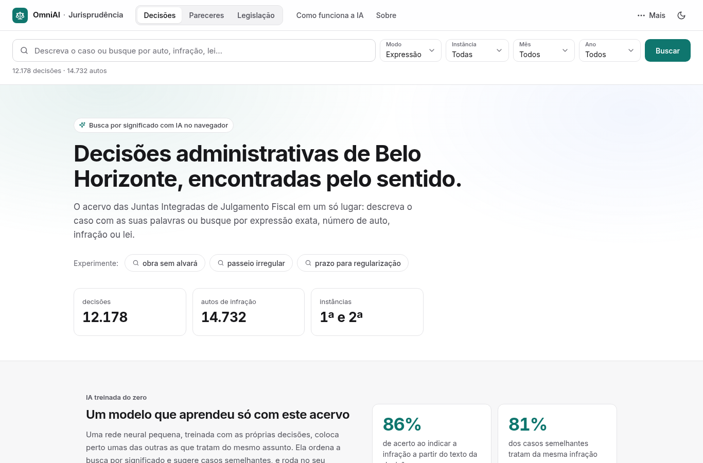
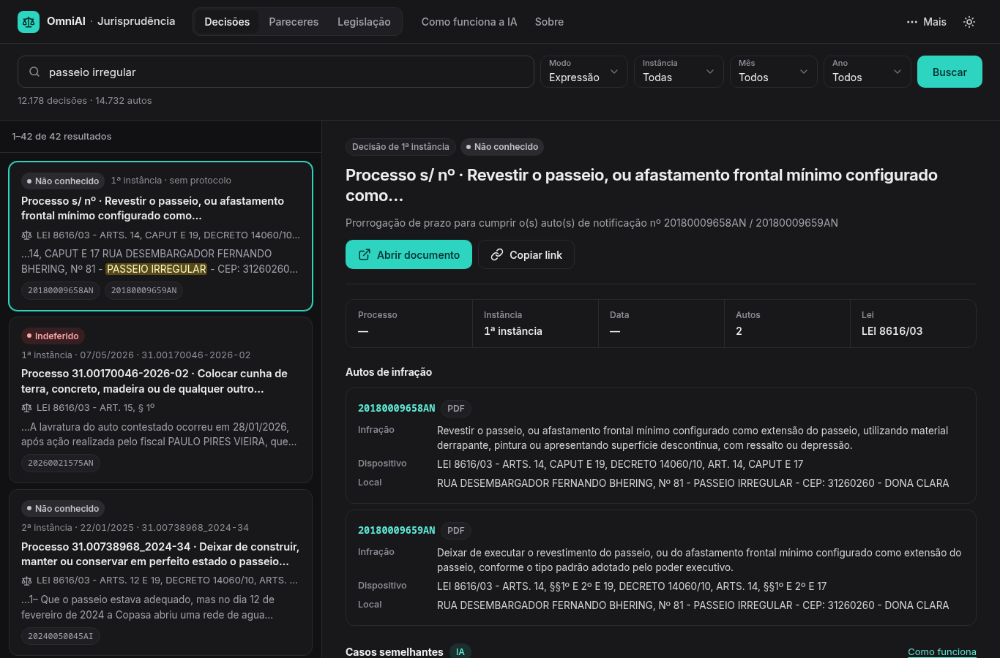
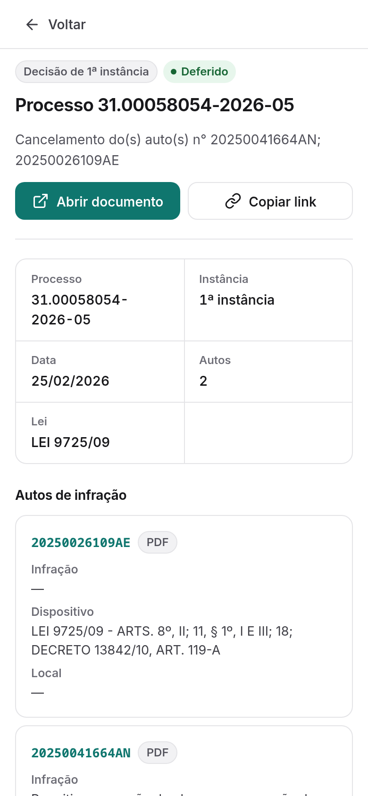
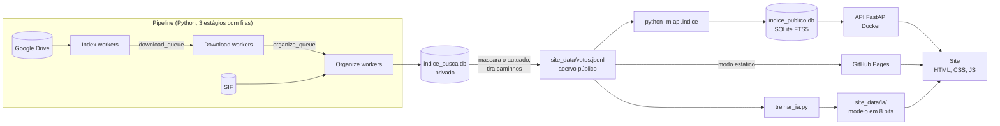

# OmniAI · Jurisprudência

[](https://github.com/sauliiin/jurisprudencia-juntas/actions/workflows/ci.yml)
[](https://github.com/sauliiin/jurisprudencia-juntas/actions/workflows/ci.yml)


[](LICENSE)

> **English summary.** Search engine for ~12,000 administrative decisions from Belo Horizonte's
> tax and inspection appeal boards. A concurrent Python pipeline (three stages linked by queues)
> collects decisions from Google Drive, extracts text from PDF/DOCX/Google Docs, enriches them with
> data from the city's inspection system and builds a SQLite FTS5 index. Personal data is masked
> before publication. A **FastAPI** service (typed responses, validation, structured logs, health
> check, Docker) serves search, and a dependency-free web front end runs a **neural model trained
> from scratch in the browser** for semantic search and similar cases (86% infraction accuracy,
> 81% precision@5 on held-out data). Tested with pytest (99% coverage), linted with ruff, built and
> smoke-tested in GitHub Actions. Next step: deployment on AWS and answers generated with Bedrock.



**Site:** [sauliiin.github.io/jurisprudencia-juntas](https://sauliiin.github.io/jurisprudencia-juntas/)
(modo estático, no GitHub Pages) · domínio futuro: `juris.omniai.com.br`

## O que é

As decisões das Juntas Integradas de Julgamento Fiscal de Belo Horizonte ficavam espalhadas em pastas
do Google Drive, em PDF, Word e Google Docs, sem busca pelo conteúdo e sem os dados do auto de infração,
que estão em outro sistema (SIF). Este projeto junta tudo num buscador:

- um **pipeline em Python** baixa e lê cada decisão, cruza com os autos do SIF e monta o índice;
- o acervo é **publicado com os dados pessoais mascarados**;
- uma **API em FastAPI** faz a busca textual (SQLite FTS5, ranking BM25);
- o **site** busca por expressão, por palavras ou por significado, com uma **IA treinada do zero**
  que roda no navegador e sugere casos semelhantes.

| Acervo | Números |
| --- | --- |
| Decisões (1ª e 2ª instância) | 12.178 |
| Autos de infração citados | 14.732 |
| Infrações distintas | 204 |
| Pareceres e ofícios | 314 |
| Legislação (artigos e itens) | 3.065, de 22 normas |

## Funcionalidades

- **Três modos de busca:** expressão exata, todas as palavras (com prefixo e sem acento) e
  significado (IA), com filtros por instância, mês e ano.
- **Decisão completa:** texto com os termos destacados, autos com infração, dispositivo legal e local,
  link para o documento original e link direto para compartilhar (`?voto=`).
- **Casos semelhantes:** as cinco decisões mais parecidas e como cada uma foi julgada.
- **Pareceres e legislação:** os mesmos recursos para o acervo de pareceres e para a legislação municipal
  dividida em artigos, com "artigos semelhantes".
- **Visual atual:** tema claro e escuro, layout de celular com filtros recolhidos e detalhe em tela cheia,
  acessibilidade (contraste AA, foco visível, navegação por teclado).
- **Dois modos de implantação:** com a API (busca no servidor, download inicial pequeno) ou estático no
  GitHub Pages (o navegador baixa o acervo e busca sozinho).

<p align="center">
  
  
  
</p>

## IA do site

Uma rede neural pequena (TF-IDF → 128 dimensões), treinada em NumPy para reconhecer a infração do auto a
partir do texto da decisão, aprende no caminho a aproximar decisões do mesmo assunto. Os pesos vão para o
navegador em 8 bits (5,5 MB) e a consulta é calculada localmente: nada do que se digita sai do computador.
O modelo é refeito do zero a cada atualização do acervo (`treinar_ia.py`).

Medido em 1.802 decisões fora do treino, com a infração registrada no SIF como gabarito:

| Métrica | Valor |
| --- | --- |
| Acerto ao indicar a infração (entre 204) | **86%** |
| Casos semelhantes com a mesma infração (precision@5; ao acaso: 4%) | **81%** |
| Busca a partir do relato do fiscal (MRR@10) | **0,60** |

Detalhes em [site_publico/ia.html](site_publico/ia.html) e [treinar_ia.py](treinar_ia.py).

## Arquitetura



- **Pipeline** ([docs/pipeline.md](docs/pipeline.md)): três estágios em paralelo desde o início, retry com
  backoff nas falhas de rede, sincronização incremental pelo `modifiedTime` do Drive e retomada por um
  marco versionado.
- **Índice público:** a API nunca abre o índice privado do pipeline; lê um SQLite gerado do JSONL já
  mascarado, com as mesmas tabelas e a mesma busca FTS5.
- **API** ([api/](api/)): rotas finas, regra de busca em `api/services/`, schemas Pydantic, configuração
  por ambiente e o site servido no mesmo processo.
- **Site** ([site_publico/](site_publico/)): sem framework e sem build; se a API não responder, cai para o
  modo estático.

## Como rodar

### Com Docker (recomendado)

```bash
docker compose up --build
```

Abra <http://localhost:8000> (site) e <http://localhost:8000/docs> (API). O compose gera o índice público a
partir de `site_data/` num volume e sobe a API depois dele, com usuário sem privilégios, sistema de arquivos
só de leitura e health check.

### Local

```bash
python3 -m venv .venv && source .venv/bin/activate
pip install -r requirements-dev.txt
python -m api.indice          # site_data/votos.jsonl -> indice_publico.db (alguns segundos)
python -m api                 # http://127.0.0.1:8000
```

Sem a API, o site também roda como arquivos estáticos (`python3 -m http.server`, abrindo `/site_publico/`).

### Configuração

Variáveis de ambiente com prefixo `JURIS_` (padrões para rodar local em [api/config.py](api/config.py)):

| Variável | Padrão | Para quê |
| --- | --- | --- |
| `JURIS_INDICE` | `indice_publico.db` | Índice SQLite público |
| `JURIS_SITE_DIR` | `site_publico/` | Site servido em `/site_publico/` |
| `JURIS_DADOS_DIR` | `site_data/` | Acervos e modelo da IA, em `/site_data/` |
| `JURIS_ARQUIVOS_DIR` | vazio | Originais para `/api/file`; vazio desliga a rota |
| `JURIS_CORS_ORIGINS` | vazio | Origens liberadas (JSON ou separadas por vírgula) |
| `JURIS_HOST` / `JURIS_PORT` | `127.0.0.1` / `8000` | Endereço do servidor |
| `JURIS_WORKERS` | `1` | Processos do uvicorn |
| `JURIS_MAX_LIMIT` | `100` | Máximo de resultados por página |
| `JURIS_LOG_LEVEL` | `INFO` | Nível dos logs (JSON, uma linha por evento) |

No front, a URL da API fica em [site_publico/config.js](site_publico/config.js) (`API_BASE`).

## API

Documentação interativa em `/docs` (OpenAPI).

| Rota | Descrição |
| --- | --- |
| `GET /health` | Status e se o índice está acessível (503 se não estiver) |
| `GET /api/stats` | Decisões, autos e documentos pulados pelo pipeline |
| `GET /api/search` | Busca paginada: `q`, `modo` (`phrase`, `words`), `instancia`, `mes`, `ano`, `limit`, `offset` |
| `GET /api/voto/{file_id}` | Decisão completa, com texto e autos |
| `GET /api/file/{file_id}` | Arquivo original (só com `JURIS_ARQUIVOS_DIR`) |

```bash
curl "http://localhost:8000/api/search?q=obra%20sem%20alvar%C3%A1&modo=phrase&limit=1"
```

```json
{
  "items": [
    {
      "file_id": "1e3e1zkqMjA2D7m_-l7yc8tjzXeKDDvfC",
      "protocolo": "31.00058054-2026-05",
      "decisao_instancia": "Decisão de 1ª instância",
      "data": "2026-02-25",
      "resultado": "deferido",
      "trecho": "...realmente iniciou uma <mark>obra sem alvará</mark> de construção...",
      "autos": [{ "numero": "20250026109AE", "lei": "LEI 9725/09" }]
    }
  ],
  "total": 38,
  "limit": 1,
  "offset": 0
}
```

(Resposta resumida; os itens trazem também links, extensão, nome do arquivo mascarado e todos os campos dos
autos.) Erros seguem um formato único, com o `request_id` que também vai no cabeçalho `X-Request-ID` e nos
logs:

```json
{"erro": {"codigo": "parametros_invalidos", "mensagem": "Parâmetros inválidos",
          "detalhes": [{"campo": "instancia", "problema": "Input should be 'todas', '1a_instancia' or '2a_instancia'"}],
          "request_id": "3542d2bef8e3415b"}}
```

## Testes e qualidade

```bash
pytest --cov          # 56 testes, 99% de cobertura no pacote api/
ruff check . && ruff format --check .
```

Os testes montam um índice SQLite com decisões fictícias e cobrem cada rota: busca por expressão e por
palavras, filtros, paginação, limites, erros 400/404/422/503, health check, arquivos, CORS e logs. A CI
([.github/workflows/ci.yml](.github/workflows/ci.yml)) roda lint, testes com cobertura e o build da imagem,
sobe o compose e faz um smoke test.

## Privacidade

O acervo é público, mas as pessoas autuadas não precisam ser:

- o nome do autuado sai dos autos e é trocado por `[AUTUADO]` no texto, no assunto, no nome do arquivo e no
  local da constatação, sem diferenciar caixa, acentos, espaços e pontuação;
- caminhos internos (`caminho_bruto`) não são publicados;
- os títulos na tela usam só processo, infração e resultado;
- a API lê só o índice gerado do acervo mascarado, e `/api/file` fica desligado por padrão;
- [scripts/verificar_acervo_publico.py](scripts/verificar_acervo_publico.py) confere o que foi publicado.

Limites conhecidos: nomes de terceiros (requerentes, procuradores, fiscais) e números de CPF/CNPJ citados no
texto não são mascarados, e o botão "Abrir documento" leva ao arquivo original no Google Drive.

## Roadmap

1. **AWS:** API em contêiner no **EC2** atrás de um **Application Load Balancer**, com **Auto Scaling**;
   índice migrado para **RDS** (PostgreSQL, busca textual e `pgvector`); cache de buscas frequentes no
   **ElastiCache** (Redis); site, modelo da IA e documentos no **S3** (com CloudFront); domínio
   `juris.omniai.com.br` no **Route 53**.
2. **Respostas com IA citando as decisões:** perguntas em linguagem natural respondidas por um modelo no
   **Amazon Bedrock** a partir das decisões recuperadas pela busca, sempre com a citação de cada uma.
3. Mascarar também CPF/CNPJ e nomes de terceiros no acervo publicado.

## Estrutura

```text
api/                  API FastAPI (rotas, serviço de busca, schemas, config, gerador do índice)
tests/                testes da API (pytest)
site_publico/         site: busca, detalhe, páginas Sobre e IA, pareceres e legislação
site_data/            acervo público (JSONL) e modelo da IA (versionados)
docs/                 documentação do pipeline, capturas de tela e fonte da imagem de compartilhamento
baixar_e_organizar_por_ato.py   pipeline de 3 estágios (Drive → texto → SIF → lei/ato)
preparar_acervo_publico.py      índice privado e exportação do JSONL mascarado
preparar_pareceres.py, legislacao.py   acervos de pareceres e legislação
treinar_ia.py         treino da IA do site
atualizar_tudo.sh     atualização completa: pipeline, IA, índice público e publicação
```

O pipeline (credenciais do Google, `.env` com o acesso ao SIF, opções e saídas) está documentado em
[docs/pipeline.md](docs/pipeline.md). O acervo também alimenta o JurisAI, projeto de RAG e agentes em
desenvolvimento.

## Licença

[MIT](LICENSE) · Saulo Hugo Rossi · [github.com/sauliiin](https://github.com/sauliiin)
