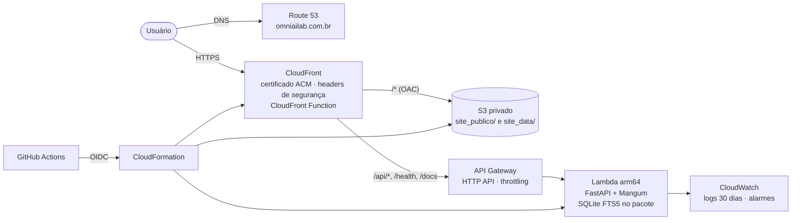

# Implantação na AWS (serverless)

Produção em **https://omniailab.com.br**, descrita como código em [`infra/aws/`](../infra/aws/) e publicada pelo
GitHub Actions ([`deploy-aws.yml`](../.github/workflows/deploy-aws.yml)) a cada push no `main`.



| Stack | Região | Conteúdo |
| --- | --- | --- |
| `omniailab-bootstrap` ([bootstrap.yaml](../infra/aws/bootstrap.yaml)) | sa-east-1 | Zona do Route 53, bucket de artefatos, provedor OIDC do GitHub, role de deploy, orçamento |
| `omniailab-certificado` ([certificado.yaml](../infra/aws/certificado.yaml)) | us-east-1 | Certificado ACM validado por DNS (o CloudFront só aceita certificados de us-east-1) |
| `omniailab-app` ([template.yaml](../infra/aws/template.yaml)) | sa-east-1 | S3, CloudFront, OAC, CloudFront Function, HTTP API, Lambda, registros DNS, alarmes |

## Decisões pelo AWS Well-Architected Framework

| Pilar | Decisão |
| --- | --- |
| Excelência operacional | Toda a infraestrutura em CloudFormation/SAM; deploy, invalidação de cache e smoke test automáticos; logs JSON com `request_id` no CloudWatch |
| Segurança | Bucket com Block Public Access, lido só pelo CloudFront via OAC e só por TLS; TLS 1.2+; `SecurityHeadersPolicy` (HSTS etc.); deploy por OIDC sem chaves de acesso, role restrita a recursos `omniailab-*` e ao branch `main`; Lambda só lê o índice público já mascarado |
| Confiabilidade | Serviços gerenciados e multi-AZ (S3, Lambda, API Gateway); versionamento do bucket; o site cai para o modo estático se a API não responder |
| Eficiência de performance | Cache no CloudFront (inclusive pontos de presença no Brasil, `PriceClass_All`); HTTP/3; acervos enviados já em gzip (o CloudFront só comprime arquivos de até 10 MB): `votos.jsonl` cai de 66 MB para ~16 MB; Lambda de 1 GB com o índice no próprio pacote, sem rede até o banco |
| Otimização de custos | Sem servidor ligado: paga por requisição; HTTP API (mais barata que REST API); Lambda arm64 (Graviton); SQLite no pacote em vez de RDS; orçamento de US$ 5 com alerta |
| Sustentabilidade | Nada ocioso; Graviton; cache e compressão reduzem tráfego e chamadas à origem |

**Por que SQLite no Lambda e não RDS/DynamoDB?** O índice é somente leitura e muda só quando o acervo é
atualizado (deploy). Empacotado com a função (~180 MB, dentro do limite de 250 MB), dá busca FTS5/BM25 em
milissegundos sem custo fixo de banco. Se o índice passar do limite, o próximo passo é imagem de contêiner
no Lambda (até 10 GB) ou EFS.

## Primeira implantação

1. Criar o stack `omniailab-bootstrap` pelo console do CloudFormation em sa-east-1 (marcar a criação de
   recursos IAM) e confirmar o e-mail do orçamento.
2. Trocar os nameservers do domínio no registrador pelos 4 da saída `NameServers` e esperar a propagação
   (`dig NS omniailab.com.br +short`).
3. No GitHub, em *Settings → Secrets and variables → Actions → Variables*: `AWS_ROLE_ARN`, `HOSTED_ZONE_ID`,
   `ARTIFACT_BUCKET` (saídas do bootstrap) e, opcional, `ALERT_EMAIL`.
4. Rodar o workflow **Deploy AWS** (ou dar push no `main`). Ele cria o certificado, o stack do app, envia o
   site e testa `/health` e `/api/search` no domínio.

Para publicar à mão (por exemplo no AWS CloudShell, com Python 3.12), com as mesmas variáveis exportadas:

```bash
pip install -r requirements-api.txt && python -m api.indice
bash infra/aws/build_lambda.sh && bash infra/aws/deploy.sh
```

## Custos aproximados

Com tráfego de portfólio: US$ 0,50 da zona do Route 53 mais centavos de S3, API Gateway e Lambda; CloudFront,
Lambda e certificado ficam na faixa gratuita. Confira na [AWS Pricing Calculator](https://calculator.aws/).
